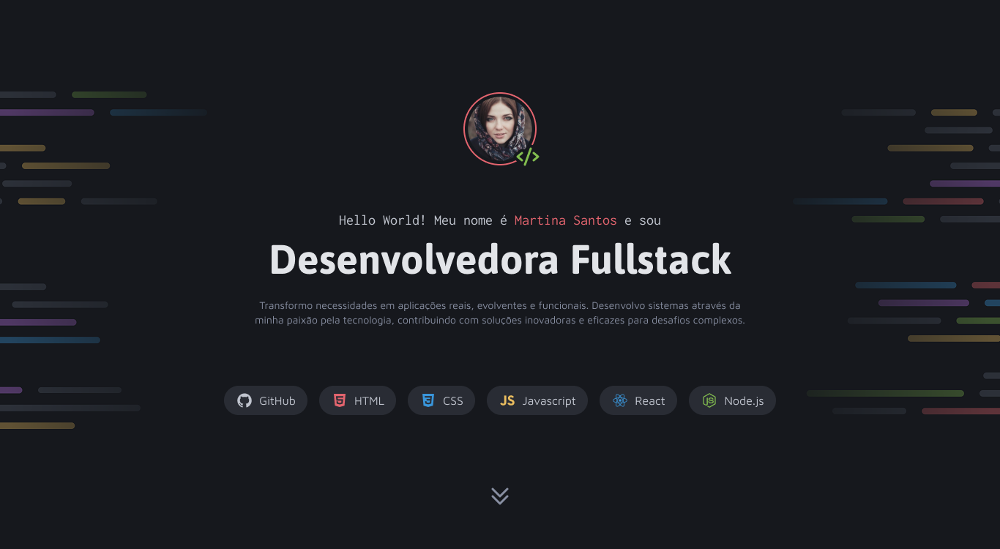
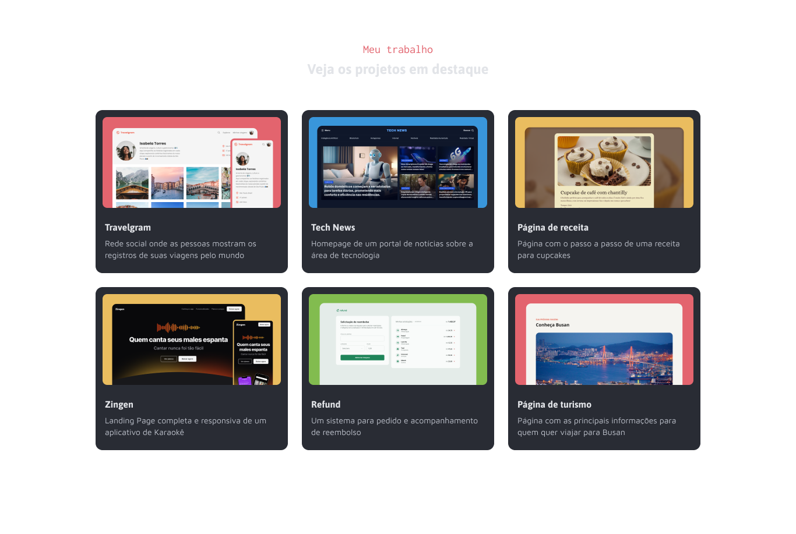
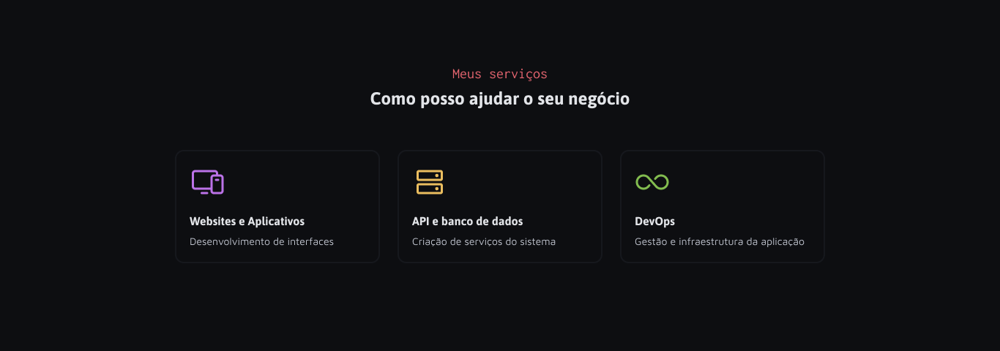
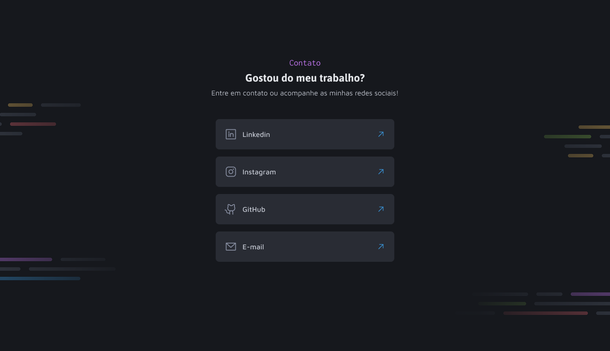

# Portfólio | Gabriel

Portfólio pessoal de desenvolvedor full stack, feito com **HTML** e **CSS** puros a partir de um layout no Figma.



## Seções

- **Introdução**: apresentação, avatar e as tecnologias com que trabalho.
- **Projetos em destaque**: grade com seis projetos (Travelgram, Tech News, Página de receita, Zingen, Refund e Página de turismo).
- **Serviços**: websites e aplicativos, API e banco de dados, DevOps.
- **Contato**: links para LinkedIn, Instagram, GitHub e e-mail.

## Tecnologias

- HTML5 semântico, com atributos de acessibilidade (`aria-*`, textos alternativos)
- CSS3 com variáveis (custom properties), Grid e Flexbox
- Layout responsivo, com breakpoints em 760px e 500px
- Respeito à preferência `prefers-reduced-motion`
- Fontes do Google Fonts: Asap, Inconsolata e Maven Pro

## Estrutura

```
Portfolio/
├── index.html
├── Assets/
│   ├── Background/       # imagens de fundo da introdução e do contato
│   ├── icons/            # ícones das tecnologias
│   └── images/           # miniaturas dos projetos
├── Projeto-figma/        # telas de referência do layout e avatar
└── styles/
    ├── global.css        # variáveis de cor, reset e estilos base
    ├── components.css    # componentes compartilhados (títulos de seção etc.)
    ├── header.css        # seção de introdução
    ├── footer.css        # seção de contato
    └── sections/
        ├── projects.css
        └── services.css
```

## Como rodar

O projeto não tem dependências nem etapa de build.

1. Clone o repositório:
   ```bash
   git clone https://github.com/Carlosamaro37/Portfolio.git
   ```
2. Abra o `index.html` no navegador. Se preferir um servidor local, use a extensão **Live Server** do VS Code.

## Layout

As telas de referência do Figma estão na pasta [`Projeto-figma/`](Projeto-figma/):

| Introdução | Projetos | Serviços | Contato |
| --- | --- | --- | --- |
|  |  |  |  |
